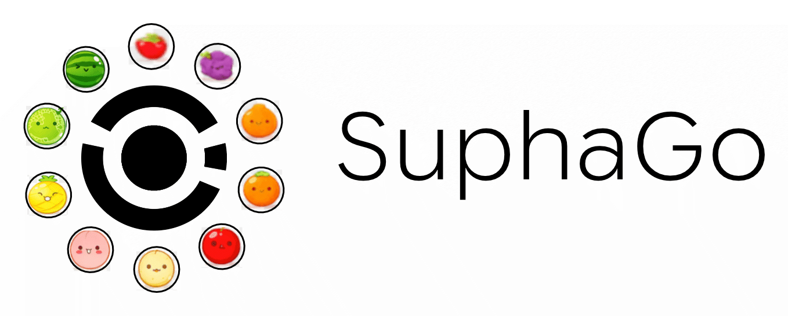

<p align="center">
  
</p>

# SuphaGo

수박게임을 스스로 학습하는 AI입니다. 이름은 Suika(수박) + AlphaGo에서 왔습니다.

웹 수박게임(playsuikagame.com)과 같은 규칙과 물리로 돌아가는 헤드리스 엔진을 만들고, 그 위에서 사람이 만든 채점 공식으로 두는 탐색 AI부터 학습된 신경망을 붙인 AI까지 단계별로 비교합니다. 만든 AI는 실제 사이트에서도 플레이할 수 있습니다.

## 진행 상황

| 단계 | 내용 | 상태 |
|---|---|---|
| 1 | 원본과 같은 헤드리스 엔진 | 완료 |
| 2 | 베이스라인 (랜덤, 타입매칭, 몬테카를로) | 완료 |
| 3 | 가치망 (판을 보고 앞으로의 점수 예측) | 완료 |
| 4 | 정책망, 깊은 탐색, 자가학습 | 진행 중 (정책망·자가학습 1회차 완료, 탐색량 실험 중) |
| 5 | 비교 정리, 웹 데모 | 예정 |

## 결과 (엔진, 60Hz)

| 에이전트 | 판 | 중앙값 | 평균 |
|---|---|---|---|
| 랜덤 | 30 | 1219 | |
| 타입매칭 (같은 과일 위에 떨어뜨리기) | 30 | 1951 | |
| 몬테카를로 1수 (후보 50곳을 굴려 보고 고르기) | 30 | 3556 | 3517 |
| 몬테카를로 2수 (다음 과일까지 굴려 보기) | 100 | 3888 | 3977 |
| 몬테카를로 1수 + 가치망 도우미 | 100 | 3880 | 3962 |
| 몬테카를로 2수 + 가치망 도우미 | 88 | 3935 | 4028 |

- 최고 기록은 10816점(1016수)입니다. 실제 사이트에서는 몬테카를로 1수가 4107점을 냈습니다(시드 0).
- 몬테카를로 2수 이상의 세 에이전트는 통계적으로 구분되지 않습니다.

**알아낸 것**
- 7000점 이상은 수박 두 개를 합쳐 없앤 판뿐입니다. 없애면 통이 66%에서 19%로 비워져 300수를 더 갑니다.
- 한 수를 무작위로 둬도 30수 뒤 점수는 거의 같습니다. 그래서 한 수 단위로 더 세밀하게 채점하는 방식(공식 보정, 가치망, 모방 정책망)은 모두 같은 벽에 막혔습니다.
- 30판 비교는 시드 운에 크게 흔들립니다. 같은 시드 50~100판과 p값으로 비교합니다.

자세한 기록은 [docs/experiments.md](docs/experiments.md)에 있습니다.

## 문서

| 문서 | 내용 |
|---|---|
| [docs/architecture.md](docs/architecture.md) | 전체 구조, 각 파일의 역할, 데이터 흐름 |
| [docs/engine.md](docs/engine.md) | 원본 분석, 물리값, 게임 규칙, 검증 방법 |
| [docs/ai.md](docs/ai.md) | 에이전트, 판 인코딩, 신경망, 학습, 모델과 데이터 버전 |
| [docs/live-play.md](docs/live-play.md) | 실제 사이트에서 플레이하는 방식과 찾은 버그들 |
| [docs/experiments.md](docs/experiments.md) | 요약, 실험 1~13의 질문·방법·결과·결론, 실수와 교훈 |
| [docs/running.md](docs/running.md) | 설치와 실행 명령 모음 (맥, 클라우드) |

## 빠른 시작

```bash
cd engine && npm ci && cd ..
cd python && pip install -r requirements.txt
python3 -m suphago.bench --agent mc --games 10 --workers 8
```

리플레이 뷰어: 레포 루트에서 `python3 -m http.server 8000` 실행 후 `http://localhost:8000/viewer/`

## 구조

```
engine/          Node.js + Matter.js 시뮬레이터 (게임 엔진, 워커, 검증 테스트)
python/suphago/  에이전트, 신경망, 학습, 벤치마크, 실제 사이트 플레이
viewer/          리플레이 뷰어
cloud/           Google Cloud 실행 스크립트 (지난 작업은 cloud/history/)
replays/         샘플 리플레이
results/         판별 벤치마크 결과, 학습 로그, 실제 사이트 기록 (목록은 results/README.md)
docs/            문서
```
